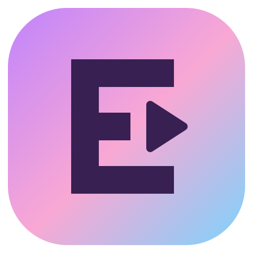

# EDITIVA

## Editar sin saber editar.

EDITIVA es una aplicación de escritorio para grabar y editar videos, pensada para quienes quieren crear contenido sin tener que aprender un programa complicado.

Nació de una necesidad concreta: hacer los cortes en una aplicación, mejorar el audio en otra y volver a empezar para terminar el video. La idea de EDITIVA es reunir ese trabajo en un mismo lugar, con herramientas fáciles de encontrar.

**Está en desarrollo y esta es una versión inicial de prueba.** Algunas funciones todavía se están ajustando.

## ¿Qué podés hacer?

- Grabar con una cámara y un micrófono conectados a tu computadora.
- Importar videos y organizarlos en proyectos.
- Recortar, dividir y acomodar clips.
- Agregar textos y música.
- Preparar videos en formatos verticales, cuadrados y horizontales.
- Exportar el resultado para compartirlo.

Las funciones disponibles y las correcciones de cada versión se detallan junto a su descarga.

## Descargar e instalar

Cuando haya una versión publicada, abrí **Releases / Versiones** en este repositorio y buscá el apartado **Assets / Archivos**.

1. Descargá el archivo que termina en **`x64-setup.exe`**.
2. Abrilo y seguí los pasos del instalador.
3. Iniciá **EDITIVA** desde el menú Inicio de Windows.

No necesitás saber programar ni instalar herramientas de desarrollo. Los archivos llamados **Source code** no son el instalador.

La distribución inicial está destinada a **Windows de 64 bits**. Ese instalador no funciona en Android, macOS ni Linux.

## Antes de empezar

- Para grabar, permití el acceso a la cámara y al micrófono cuando Windows lo solicite.
- Elegí dónde guardar tus grabaciones y comprobá que haya espacio libre.
- Conservá los videos, imágenes y audios originales de tus proyectos.
- Hacé una grabación corta y una exportación de prueba antes de trabajar en un video importante.

**Procesamiento de video:** la configuración de la versión 0.1.0 revisada no incorpora FFmpeg y FFprobe al instalador. Son componentes que EDITIVA necesita para procesar videos. Revisá las instrucciones de la versión que descargues; si informa que faltan, no es un error de tu proyecto.

## Tu primer video

1. Elegí **Grabar Rápido** para grabarte o **Importar para Editar** si ya tenés un video.
2. Seleccioná el formato que necesitás.
3. Acomodá y recortá los clips; agregá los elementos que quieras.
4. Revisá el video y escuchá el audio.
5. Exportá y comprobá el archivo final antes de publicarlo.

Las guías de redes sociales son una referencia: las interfaces y los recortes pueden variar según la plataforma y el dispositivo.

## Actualizaciones

El sistema de actualizaciones está en preparación. **Por ahora no damos por garantizada la actualización desde la app.**

Cuando se habilite y pruebe, EDITIVA podrá consultar nuevas versiones por internet y ofrecer su instalación desde **Configuración**. Las notas de cada versión indicarán si ya está disponible.

Mientras tanto, descargá el instalador nuevo desde Releases y seguí sus instrucciones. Subir un archivo nuevo a Drive no actualiza una aplicación ya instalada.

## Si algo no funciona

Anotá qué estabas haciendo, la versión de EDITIVA y el mensaje que apareció. Si podés, sumá una captura para compartirla con quien te invitó a probar la app.

Antes de compartir capturas o videos, revisá que no incluyan datos personales o material que prefieras mantener privado.

## Sobre este espacio

Este repositorio contiene la presentación de EDITIVA, su guía de uso y sus versiones descargables. El código fuente se mantiene en un repositorio privado separado.

Creado por **Meli — PenguinCoder**.
